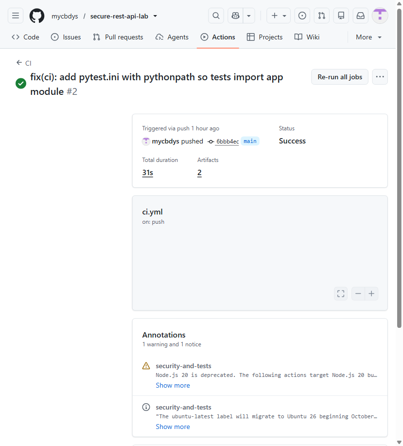
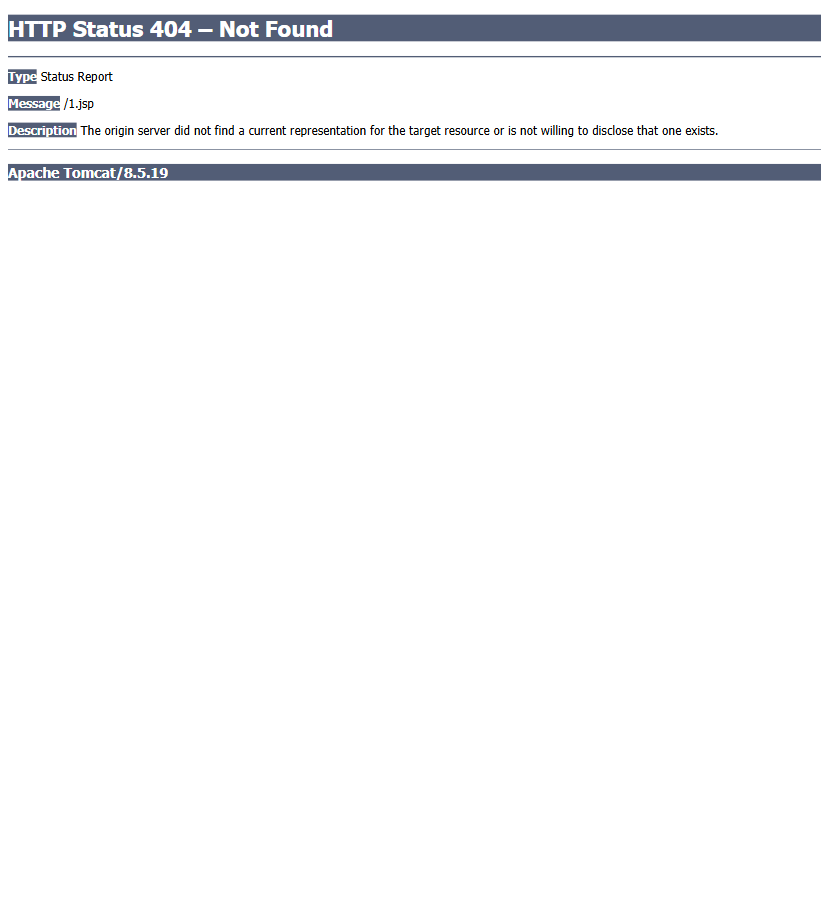

# Secure REST API — Lab Work 1 (HDU IS)

A deliberately **secure** Flask REST API built for Laboratory Work 1: *Secure REST API
Development with CI/CD and Real CVE Vulnerability Analysis*.

It demonstrates a full security lifecycle: OWASP Top-10 protection in the application,
automated SAST/SCA scanning in CI/CD, and the analysis + remediation of a **real CVE**
reproduced with [Vulhub](https://github.com/vulhub/vulhub) in Docker.

---

## 1. Project overview & API

**Stack:** Python 3.11+ · Flask · SQLite · PyJWT · bcrypt

The API is a minimal blog-like service with JWT authentication.

| Method | Endpoint         | Auth required | Description                                              |
|--------|------------------|---------------|----------------------------------------------------------|
| POST   | `/auth/login`    | No            | Authenticate with username + password, returns a JWT     |
| GET    | `/api/data`      | **Yes**       | Returns user records (optional `?username=` filter)      |
| POST   | `/api/posts`     | **Yes**       | Create a post; content is stored raw but escaped on output |
| GET    | `/api/posts`     | **Yes**       | List posts; all content is HTML-escaped (XSS protection) |
| GET    | `/api/profile`   | **Yes**       | Returns the current authenticated user                   |

### How to call

```bash
# 1) Login -> get a JWT
curl -X POST http://localhost:5000/auth/login \
     -H "Content-Type: application/json" \
     -d '{"username":"testuser","password":"Test@1234"}'
# -> {"token":"eyJhbGciOi..."}

# 2) Access a protected endpoint with the token
curl http://localhost:5000/api/data \
     -H "Authorization: Bearer <token>"

# 3) Create a post (content is escaped on output)
curl -X POST http://localhost:5000/api/posts \
     -H "Authorization: Bearer <token>" -H "Content-Type: application/json" \
     -d '{"content":"<script>alert(1)</script>"}'
# -> {"content":"&lt;script&gt;alert(1)&lt;/script&gt;", ...}
```

Demo account: `testuser` / `Test@1234` (seeded on first run; hash stored in SQLite).

Run locally:

```bash
python -m venv .venv
.venv\Scripts\activate        # Windows
pip install -r requirements.txt -r requirements-dev.txt
python app.py                  # starts on http://127.0.0.1:5000
```

---

## 2. Security measures implemented

### 2.1 SQL Injection protection (parameterized queries)
All database access uses **parameterized queries** (`?` placeholders) with Python's
`sqlite3`. User input only ever binds as a *value*, never concatenated into SQL text.
See `login()` and `api_data()` in `app.py`. A payload like `' OR '1'='1' --` is treated
as a literal username and matches nothing. *(OWASP A03:2021 — Injection)*

### 2.2 XSS protection (output escaping)
Any user-supplied data returned to the client is escaped with `html.escape()` before
it leaves the server (see `create_post()` and `list_posts()`). Stored content such as
`<script>alert(1)</script>` is returned as `&lt;script&gt;alert(1)&lt;/script&gt;`, so it
cannot execute in the browser. *(OWASP A03:2021 — stored XSS)*

### 2.3 Authentication & broken-authentication protection
- Passwords are **never stored in plaintext** — hashed with **bcrypt** (`bcrypt.gensalt()`,
  salted, one-way). Verification uses constant-time `bcrypt.checkpw()`.
- On successful login a **JWT (HS256)** is issued with `sub`, `iat`, `exp`.
- The `login_required` middleware verifies the Bearer JWT (signature, expiry) on every
  protected endpoint; missing/tampered/expired tokens are rejected with `401`.
  *(OWASP A07:2021 — Identification and Authentication Failures)*
- The JWT signing key defaults to a **≥32-byte** value (RFC 7518 key-length requirement)
  and must be overridden via the `SECRET_KEY` environment variable in production.

---

## 3. CI/CD pipeline with SAST & SCA

Workflow: **`.github/workflows/ci.yml`** (GitHub Actions). Runs on **every push and every
pull request** to `main`.

- **SAST — Bandit** (`bandit -r app.py`): static application security testing.
  Result: **0 issues** (production code).
- **SCA — pip-audit** (`pip-audit -r requirements.txt`): dependency / software-composition
  analysis against the OSV database. Result: **no known vulnerabilities**.
- **Tests** (`pytest`): 13 automated tests covering auth, access control, SQLi and XSS.
- Reports (`bandit-report.html`, `pip-audit-report.json`) are uploaded as **artifacts**.

### Last successful pipeline run
**Status: ✅ Success** — <https://github.com/mycbdys/secure-rest-api-lab/actions/runs/39197028589>
(commit `6bbb4ec`, 31 s, 2 artifacts)



Screenshots of the SAST/SCA reports (downloaded artifacts from the Actions tab):


---

## 4. Selected vulnerability (CVE)

- **CVE ID:** **CVE-2017-12615** — Apache Tomcat PUT-method arbitrary file write → JSP upload → RCE
- **Component / version:** Apache Tomcat 8.5.19 (`vulhub/tomcat:8.5.19`, Vulhub directory `tomcat/CVE-2017-12615`)
- **Official description (NVD):** "When running Apache Tomcat 7.0.0 to 7.0.79 on Windows
  with HTTP PUTs enabled (e.g. via setting the `readonly` initialisation parameter of the
  Default servlet to `false`) it was possible to upload a JSP file to the server via a
  specially crafted request. This JSP could then be requested and any code it contained
  would be executed by the server." — <https://nvd.nist.gov/vuln/detail/CVE-2017-12615>
- **Note on version:** the Vulhub environment we used is Tomcat **8.5.19 on Linux** — the
  same root cause (DefaultServlet `readonly=false` enables PUT uploads) also affects the
  8.5.x line and is tracked there as **CVE-2017-12617**; the bypass we demonstrate (trailing
  slash `PUT /1.jsp/`) is the Linux variant. Root cause and remediation are identical.
- **Environment:** Docker Compose from `vulhub/tomcat/CVE-2017-12615/`, port `8080`.

### Reproduction steps (all recorded, see `fixes/verification.log`)

```bash
# 1) Build & start the vulnerable environment
cd vulhub/tomcat/CVE-2017-12615
docker compose build && docker compose up -d
# Tomcat available at http://localhost:8080/

# 2) Upload a JSP "webshell" via the trailing-slash PUT bypass
curl -X PUT --data-binary @payload.jsp http://localhost:8080/1.jsp/
# -> HTTP 204 (file written to the web root as /1.jsp)

# 3) Request the uploaded JSP -> arbitrary code execution
curl http://localhost:8080/1.jsp
# -> uid=0(root) gid=0(root) groups=0(root)   [RCE as root]
```


### Root cause analysis
Two weaknesses combine:
1. **Insecure configuration:** the DefaultServlet in `conf/web.xml` is configured with
   `<init-param><param-name>readonly</param-name><param-value>false</param-value></init-param>`,
   which enables the HTTP **PUT** method for static resources — the server accepts
   arbitrary file content and writes it to disk.
2. **Improper input validation / bypass:** Tomcat refuses to write files whose extension
   (e.g. `.jsp`) is dangerous. However, a request to `PUT /1.jsp/` — with a **trailing
   slash** — defeats the extension check: the check is performed on the raw URI, while
   the filesystem-level normalization strips the trailing slash and stores the file as
   `1.jsp`. The uploaded JSP is then compiled and executed by the JSP engine with the
   privileges of the Tomcat process (root in the container), giving **remote code
   execution**.

This is a **configuration flaw + improper input validation** (CWE-434: Unrestricted
Upload of File with Dangerous Type; CWE-20: Improper Input Validation), not a memory
corruption bug.

### Applied fix
Restore the **secure default**: set `readonly=true` in the DefaultServlet configuration
(modified `Dockerfile`, see `fixes/`). The same result is achieved in production by
upgrading Tomcat to a patched release (≥ 7.0.80 / 8.5.39) and keeping PUT disabled.

```dockerfile
# Dockerfile (fixed) — change injected param-value from false to true:
RUN cd /usr/local/tomcat/conf \
    && LINE=$(nl -ba web.xml | grep '<load-on-startup>1' | awk '{print $1}') \
    && ADDON="<init-param><param-name>readonly</param-name><param-value>true</param-value></init-param>" \
    && sed -i "$LINE i $ADDON" web.xml
```

```bash
docker compose down
docker compose up --build -d    # rebuild with the fixed image
```

### Proof of vulnerability elimination

```text
VULNERABLE (readonly=false):          FIXED (readonly=true):
  PUT /1.jsp/  -> HTTP 204              PUT /1.jsp/  -> HTTP 403 (write blocked)
  GET /1.jsp   -> uid=0(root)...        GET /1.jsp   -> HTTP 404 (no shell)
                                        GET /        -> HTTP 200 (regression OK)
```



---

## 5. Repository layout

```
secure-api/
├── app.py                    # Flask application (all security logic)
├── requirements.txt          # runtime deps
├── requirements-dev.txt      # test + scanning deps
├── pytest.ini                # pytest config (pythonpath)
├── tests/test_api.py         # 13 pytest cases (auth/SQLi/XSS/access control)
├── .github/workflows/ci.yml  # CI/CD (SAST bandit + SCA pip-audit + tests)
├── fixes/                    # CVE fix files (Dockerfile, docker-compose, log)
│   ├── Dockerfile            # fixed (readonly=true)
│   ├── docker-compose.yml
│   ├── verification.log      # attack + fix evidence
│   └── original/             # untouched vulnerable files
├── docs/                     # evidence screenshots & CI artifacts
└── local-verification.txt    # local e2e verification log
```

---

## 6. Student details
- Laboratory work: **№1 — Secure REST API Development with CI/CD and Real CVE Vulnerability Analysis**
- Variant: ***(pending)***
- Student: **Li Zetao**
- HDU number: **23320332**
